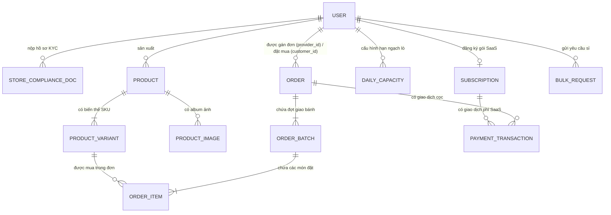

# 📚 System Data Dictionary Specification (Từ Điển Dữ Liệu Kỹ Thuật - Toàn Diện)

> Cập nhật 2026-10-16: Schema đích theo [hợp đồng Backend](backend-ownership-and-order-contract.md); không phản ánh đầy đủ entity hiện tại. BE4 sửa entity/repository trực tiếp trong dev, không thêm Flyway/migration, BE3 triển khai lifecycle. SaaS MVP chỉ nạp phí/kích hoạt quyền bán.

- **Mã tài liệu**: `SPEC-DATA-01`
- **Dự án**: `Nền Tảng Bán Bánh Trung Thu Trực Tuyến`
- **Phiên bản**: `v1.4.0` (2026-10-16: transaction, COD, hold và ownership)
- **Thư mục**: `docs/BRD/04-agent-and-dev-guidelines/system-data-dictionary.md`
- **Tài liệu căn cứ**: `docs/BRD/`, `docs/BRD/srs.md`, Codebase `be/src/main/java/fpt/sba/trungthu/entity/`

---

## 1. Danh Sách Thực Thể & Phân Định Phạm Vi (Entity Inventory & Scoping)

Toàn bộ các thực thể trong cơ sở dữ liệu được giữ nguyên vẹn trong cấu trúc hệ thống và được phân định phạm vi rõ ràng:

### 🟢 Nhóm Thực Thể Cốt Lõi Vận Hành MVP (In-Scope MVP)
1. **`User` (`USER`)**: Quản lý tài khoản toàn hệ thống (`CUSTOMER`, `PROVIDER`, `PLATFORM_ADMIN`), trạng thái duyệt hồ sơ ATTP (`is_compliance_approved`), công tắc nhận đơn (`is_season_active`) và **thông tin ngân hàng Provider** (`bank_code`, `bank_account_number`, `bank_account_name`) để sinh mã VietQR.
2. **`StoreComplianceDoc` (`STORE_COMPLIANCE_DOC`)**: Hồ sơ pháp lý ATTP và ĐKKD của nhà sản xuất.
3. **`Subscription` (`SUBSCRIPTION`)**: Quyền bán SaaS của Provider sau khi nạp phí và được Admin kích hoạt; không bắt buộc phân hạng gói trong MVP.
4. **`Product` (`PRODUCT`)**: Dòng sản phẩm (Bánh lẻ, Hộp đóng sẵn tiêu chuẩn, Thiệp chúc mừng).
5. **`ProductVariant` (`PRODUCT_VARIANT`)**: Biến thể SKU hàng hóa (Trọng lượng 150g/200g/250g, Hộp Set 2/4/6 tiêu chuẩn, giá bán, tồn kho).
6. **`ProductImage` (`PRODUCT_IMAGE`)**: Album hình ảnh của sản phẩm và biến thể.
7. **`DailyCapacity` (`DAILY_CAPACITY`)**: Hạn ngạch nướng bánh theo ngày Dương Lịch (`capacity_date` / `bake_date`) của Provider.
8. **`Order` (`ORDER`)**: Đơn hàng mua sắm. **Quy tắc Hướng A**: Giỏ hàng cho phép nhặt đa Provider, nhưng lúc Checkout hệ thống **tự động tách thành các Order con độc lập theo từng `provider_id`**. Lưu tiền cọc, phương thức, phí ship, thông tin VAT và deadline/audit hold.
9. **`OrderBatch` (`ORDER_BATCH`)**: Đợt giao hàng kết nối ngày nhận bánh tươi (`delivery_date`).
10. **`OrderItem` (`ORDER_ITEM`)**: Chi tiết các biến thể bánh lẻ / set hộp tiêu chuẩn trong đơn hàng.
11. **`PaymentTransaction` (`PAYMENT_TRANSACTION`)**: Giao dịch thanh toán cọc đơn hàng qua VietQR và nộp phí thuê SaaS (`SUBSCRIPTION_FEE`).
12. **`BulkRequest` (`BULK_REQUEST` / `b2b_rfqs`)**: Tiếp nhận yêu cầu mua số lượng lớn ($\ge 20$ hộp) và hiển thị trên Dashboard Provider.
13. **`SystemConfig` (`SYSTEM_CONFIG`)**: Cặp key-value lưu cấu hình hệ thống chung (hotline, thông báo sàn).

---

### 🟡 Nhóm Thực Thể Mở Rộng Giai Đoạn 2 (Phase 2 Entities - Retained in Codebase)
*Các thực thể này đã có sẵn trong cấu trúc Entity của Backend, được giữ nguyên vẹn để bảo đảm tính mở rộng của đồ án, nhưng không bắt buộc phải hoàn thiện toàn bộ luồng nghiệp vụ trong 4 tuần MVP:*

14. **`CustomBox` (`CUSTOM_BOX`) `[Phase 2]`**: Hộp quà tùy chỉnh ghép từng vị bánh lẻ theo ô slot + In tên riêng lên vỏ hộp bằng CSS Overlay.
15. **`CustomBoxItem` (`CUSTOM_BOX_ITEM`) `[Phase 2]`**: Vị trí các bánh lẻ đặt vào từng ô slot trong hộp quà tùy chỉnh.
16. **`ProductionBatch` (`PRODUCTION_BATCH`) `[Phase 2]`**: Bảng theo dõi từng mẻ lò nướng vật lý tại xưởng (Trong MVP, Phiếu Ra Lò được tính toán động bằng SQL Query gom theo `bake_date = delivery_date - 1`).
17. **`ProviderQuotation` (`PROVIDER_QUOTATION`) `[Phase 2]`**: Bảng nộp báo giá kín tham gia đấu thầu RFQ doanh nghiệp.
18. **`Complaint` (`COMPLAINT`) `[Phase 2]`**: Bảng khiếu nại sản phẩm tươi trong 24h kèm upload video unboxing (Trong MVP, hệ thống chỉ hiển thị UI cam kết Keep-the-Item Refund).
19. **`UserSocialAccount` (`USER_SOCIAL_ACCOUNT`) `[Phase 2]`**: Bảng liên kết tài khoản mạng xã hội Google OAuth2 (Trong MVP, hệ thống sử dụng Local Auth JWT).

---

## 2. Chi Tiết Thuộc Tính & Kiểu Dữ Liệu Từng Thực Thể (Field Schemas)

### 2.1 Thực thể `User` (Bảng `USER`) - `[MVP]`
- **Mô tả**: Quản lý tài khoản toàn hệ thống, phân quyền và tài khoản ngân hàng để sinh ảnh VietQR cho Provider.

| Tên Trường (Field) | Kiểu Dữ Liệu (Type) | Nullable | Khóa (PK/FK) | Ý Nghĩa Nghiệp Vụ & Quy Tắc Kiểm Tra (Validation) |
| :--- | :--- | :--- | :--- | :--- |
| `id` | `UUID` | No | PK | Định danh duy nhất tài khoản (`BaseEntity`). |
| `email` | `VARCHAR(254)` | No | UNIQUE | Email đăng nhập. |
| `password` | `VARCHAR(255)` | No | - | Mật khẩu băm BCrypt. |
| `full_name` | `VARCHAR(255)` | No | - | Họ và tên người dùng. |
| `phone` | `VARCHAR(20)` | Yes | - | Số điện thoại liên hệ (10 chữ số). |
| `role` | `VARCHAR(30)` | No | - | Enum: `CUSTOMER`, `PROVIDER`, `PLATFORM_ADMIN`. |
| `store_name` | `VARCHAR(255)` | Yes | - | Tên thương hiệu/xưởng (bắt buộc nếu role = `PROVIDER`). |
| `address` | `TEXT` | Yes | - | Địa chỉ liên hệ / cơ sở sản xuất. |
| `bank_code` | `VARCHAR(20)` | Yes | - | **[Mới cập nhật]** Mã ngân hàng nhận tiền VietQR (VD: `VCB`, `MB`, `TCB`). |
| `bank_account_number` | `VARCHAR(50)` | Yes | - | **[Mới cập nhật]** Số tài khoản ngân hàng của Provider. |
| `bank_account_name` | `VARCHAR(150)` | Yes | - | **[Mới cập nhật]** Tên chủ tài khoản ngân hàng (viết hoa không dấu). |
| `is_compliance_approved`| `BOOLEAN` | No | - | Cờ duyệt hồ sơ ATTP & KYC (`false` mặc định, Admin duyệt chuyển `true`). |
| `is_season_active` | `BOOLEAN` | No | - | Công tắc Mở/Tạm ngừng nhận đơn thủ công của Provider (`true` mặc định). |
| `status` | `VARCHAR(30)` | No | - | Trạng thái tài khoản: `ACTIVE`, `BLOCKED`. |

---

### 2.2 Thực thể `StoreComplianceDoc` (Bảng `STORE_COMPLIANCE_DOC`) - `[MVP]`
- **Mô tả**: Tài liệu chứng nhận ATTP và ĐKKD của nhà sản xuất.

| Tên Trường (Field) | Kiểu Dữ Liệu (Type) | Nullable | Khóa (PK/FK) | Ý Nghĩa Nghiệp Vụ & Quy Tắc Kiểm Tra (Validation) |
| :--- | :--- | :--- | :--- | :--- |
| `id` | `UUID` | No | PK | Định danh tài liệu (`BaseEntity`). |
| `provider_id` | `UUID` | No | FK (`USER.id`) | Provider nộp hồ sơ. |
| `document_type` | `VARCHAR(255)` | No | - | Loại hồ sơ: `FOOD_SAFETY_CERT`, `BUSINESS_LICENSE`, `IDENTITY_KYC`. |
| `document_url` | `VARCHAR(2048)`| No | - | Link lưu trữ file trên CDN/S3. |
| `verification_status` | `VARCHAR(30)` | No | - | Enum: `PENDING`, `APPROVED`, `REJECTED`. |
| `verified_by` | `UUID` | Yes | FK (`USER.id`) | Admin thực hiện duyệt. |
| `submitted_at` | `TIMESTAMP` | No | - | Thời điểm nộp. |
| `verified_at` | `TIMESTAMP` | Yes | - | Thời điểm Admin phê duyệt. |

---

### 2.3 Thực thể `Subscription` (Bảng `SUBSCRIPTION`) - `[MVP]`
- **Mô tả**: Hợp đồng gói SaaS của xưởng bánh. Duyệt kích hoạt thủ công bởi Admin sau khi nhận chuyển khoản.

| Tên Trường (Field) | Kiểu Dữ Liệu (Type) | Nullable | Khóa (PK/FK) | Ý Nghĩa Nghiệp Vụ & Quy Tắc Kiểm Tra (Validation) |
| :--- | :--- | :--- | :--- | :--- |
| `id` | `UUID` | No | PK | Định danh hợp đồng gói SaaS (`CreatedEntity`). |
| `provider_id` | `UUID` | No | FK (`USER.id`) | Xưởng sở hữu gói (1 xưởng có 1 gói ACTIVE). |
| `plan_name` | `VARCHAR(255)` | No | - | Tên cấu hình quyền bán; không hardcode STANDARD/VIP trong MVP. |
| `price` | `DECIMAL(18,2)`| No | - | Mức phí gói trả cho sàn (VNĐ). |
| `start_date` | `DATE` | No | - | Ngày bắt đầu hiệu lực (`LocalDate`). |
| `end_date` | `DATE` | No | - | Ngày kết thúc hiệu lực (`LocalDate`). |
| `max_products_allowed` | `INT` | No | - | Giới hạn SKU cấu hình bởi BE1, không buộc theo hạng gói. |
| `is_featured` | `BOOLEAN` | No | - | Cờ mở rộng Phase 2; MVP mặc định false, không có quyền quảng cáo theo gói. |
| `status` | `VARCHAR(30)` | No | - | Enum: `PENDING_PAYMENT`, `ACTIVE`, `SUSPENDED`. |

---

### 2.4 Thực thể `Product` (Bảng `PRODUCT`) - `[MVP]`
- **Mô tả**: Dòng sản phẩm cha, phân loại hàng hóa và thời hạn bảo quản bánh tươi.

| Tên Trường (Field) | Kiểu Dữ Liệu (Type) | Nullable | Khóa (PK/FK) | Ý Nghĩa Nghiệp Vụ & Quy Tắc Kiểm Tra (Validation) |
| :--- | :--- | :--- | :--- | :--- |
| `id` | `UUID` | No | PK | Định danh dòng sản phẩm gốc (`BaseEntity`). |
| `provider_id` | `UUID` | No | FK (`USER.id`) | Xưởng sản xuất sở hữu sản phẩm. |
| `name` | `VARCHAR(255)` | No | - | Tên dòng bánh hoặc hộp quà tiêu chuẩn. |
| `description` | `TEXT` | Yes | - | Mô tả chi tiết thành phần, hương vị. |
| `product_type` | `VARCHAR(30)` | No | - | Enum: `LOOSE_CAKE`, `BOX_SHELL`, `GREETING_CARD`, `ADDON_SERVICE`. |
| `status` | `VARCHAR(30)` | No | - | Trạng thái: `ACTIVE`, `INACTIVE`. |

---

### 2.5 Thực thể `ProductVariant` (Bảng `PRODUCT_VARIANT`) - `[MVP]`
- **Mô tả**: Biến thể bán hàng SKU (Trọng lượng, kích cỡ hộp đóng sẵn, đơn giá niêm yết và tồn kho).

| Tên Trường (Field) | Kiểu Dữ Liệu (Type) | Nullable | Khóa (PK/FK) | Ý Nghĩa Nghiệp Vụ & Quy Tắc Kiểm Tra (Validation) |
| :--- | :--- | :--- | :--- | :--- |
| `id` | `UUID` | No | PK | Định danh biến thể SKU (`BaseEntity`). |
| `product_id` | `UUID` | No | FK (`PRODUCT.id`)| Thuộc dòng sản phẩm cha nào. |
| `variant_name` | `VARCHAR(255)` | No | - | Tên biến thể (VD: "Thập Cẩm 200g Trứng Muối", "Set Hộp Đoàn Viên 4 Bánh"). |
| `sku` | `VARCHAR(255)` | No | UNIQUE | Mã SKU biến thể (VD: `BANH-THAPCAM-200G`). |
| `price` | `DECIMAL(18,2)`| No | - | Giá niêm yết bán lẻ (VNĐ). |
| `stock_quantity` | `INT` | No | - | Số lượng tồn kho thực tế ($\ge 0$). |
| `weight_gram` | `INT` | Yes | - | Khối lượng bánh (150, 200, 250) - Chỉ dùng cho bánh lẻ. |
| `box_capacity` | `INT` | Yes | - | Dung tích ô chứa (2, 4, 6 bánh) - Dùng cho hộp quà. |
| `status` | `VARCHAR(30)` | No | - | Trạng thái: `AVAILABLE`, `OUT_OF_STOCK`. |

---

### 2.6 Thực thể `ProductImage` (Bảng `PRODUCT_IMAGE`) - `[MVP]`
- **Mô tả**: Album hình ảnh của sản phẩm.

| Tên Trường (Field) | Kiểu Dữ Liệu (Type) | Nullable | Khóa (PK/FK) | Ý Nghĩa Nghiệp Vụ |
| :--- | :--- | :--- | :--- | :--- |
| `id` | `UUID` | No | PK | Định danh ảnh (`CreatedEntity`). |
| `product_id` | `UUID` | No | FK (`PRODUCT.id`)| Thuộc sản phẩm nào. |
| `image_url` | `VARCHAR(2048)`| No | - | Đường dẫn ảnh CDN/S3. |
| `is_primary` | `BOOLEAN` | No | - | Ảnh đại diện chính. |
| `display_order` | `INT` | No | - | Thứ tự sắp xếp hiển thị ảnh. |

---

### 2.7 Thực thể `DailyCapacity` (Bảng `DAILY_CAPACITY`) - `[MVP]`
- **Mô tả**: Hạn ngạch nướng bánh theo ngày Dương Lịch (`capacity_date` / `bake_date`) của từng xưởng.

| Tên Trường (Field) | Kiểu Dữ Liệu (Type) | Nullable | Khóa (PK/FK) | Ý Nghĩa Nghiệp Vụ & Quy Tắc Kiểm Tra (Validation) |
| :--- | :--- | :--- | :--- | :--- |
| `id` | `UUID` | No | PK | Định danh bản ghi hạn ngạch ngày (`BaseEntity`). |
| `provider_id` | `UUID` | No | FK (`USER.id`) | Provider áp dụng hạn ngạch. |
| `capacity_date` | `DATE` | No | - | Ngày ra lò bánh theo chuẩn Dương Lịch (`LocalDate`). |
| `max_quantity` | `INT` | No | - | Hạn ngạch nướng tối đa trong ngày (VD: 500 chiếc). |
| `reserved_quantity`| `INT` | No | - | Số lượng bánh đã được giữ chỗ từ các đơn hàng. |
| `available_quantity`| `INT` | No | - | Số bánh còn nhận được (`max_quantity - reserved_quantity`). |

---

### 2.8 Thực thể `Order` (Bảng `ORDER`) - `[MVP]`
- **Mô tả**: Đơn hàng mua sắm. **Theo Hướng A**: Giỏ hàng chung nhặt đa Provider, nhưng lúc Checkout hệ thống tự động tách thành các Đơn Hàng con độc lập theo từng `provider_id`.

| Tên Trường (Field) | Kiểu Dữ Liệu (Type) | Nullable | Khóa (PK/FK) | Ý Nghĩa Nghiệp Vụ & Quy Tắc Kiểm Tra (Validation) |
| :--- | :--- | :--- | :--- | :--- |
| `id` | `UUID` | No | PK | Định danh đơn hàng (`BaseEntity`). |
| `order_code` | `VARCHAR(255)` | No | UNIQUE | Mã đơn hiển thị (VD: `ORD-20260915-0012`). |
| `customer_id` | `UUID` | No | FK (`USER.id`) | Người mua (bắt buộc tài khoản BUYER/CUSTOMER). |
| `provider_id` | `UUID` | No | FK (`USER.id`) | **[Cập nhật theo Hướng A]** Duy nhất 1 Provider nhận đơn này sau khi tách giỏ. |
| `checkout_id` | `UUID` | No | INDEX | Liên kết các Order cùng một Checkout, không phải Order cha. |
| `subtotal_amount` | `DECIMAL(18,2)` | No | - | Tổng tiền hàng snapshot. |
| `total_amount` | `DECIMAL(18,2)`| No | - | Tổng tiền: tiền hàng + ship + phụ phí; ngưỡng cọc/COD tính trên Order này. |
| `deposit_amount` | `DECIMAL(18,2)`| No | - | Khoản phải chuyển ban đầu cho VIETQR, tối thiểu 50% hoặc trả đủ; COD = 0. Không phải số tiền đã nhận. |
| `payment_method` | `VARCHAR(30)` | No | - | **[Cập nhật]** Phương thức: `VIETQR` hoặc `COD`. |
| `order_status` | `VARCHAR(30)` | No | - | VIETQR: PENDING_DEPOSIT → DEPOSITED → BAKING_QUEUED → DELIVERING → COMPLETED. COD bắt đầu CONFIRMED rồi vào BAKING_QUEUED. CANCELLED chỉ theo bảng lifecycle trong hợp đồng Backend. |
| `payment_status` | `VARCHAR(30)` | No | - | Trạng thái thanh toán: `UNPAID`, `DEPOSITED`, `PAID_FULL`. |
| `shipping_address` | `TEXT` | No | - | Địa chỉ nhận hàng của khách. |
| `shipping_fee` | `DECIMAL(18,2)`| No | - | **[Cập nhật]** Phí vận chuyển tiêu chuẩn cho đơn hàng này. |
| `ordered_at` | `UTC timestamp` | No | - | Instant UTC lúc đặt; API ISO-8601 có Z. |
| `hold_expires_at` | `UTC timestamp` | Yes | INDEX | Chỉ đang PENDING_DEPOSIT: ban đầu ordered_at +15 phút; COD/đã cọc/hủy = null. |
| `hold_extension_count` | `INT` | No | - | Mặc định 0, chỉ 0 hoặc 1. |
| `hold_extended_at` | `UTC timestamp` | Yes | - | Instant UTC lần gia hạn. |
| `hold_extended_by` | `UUID` | Yes | FK USER | Provider sở hữu thực hiện gia hạn. |
| `hold_extension_reason` | `VARCHAR(500)` | Yes | - | Lý do bắt buộc khi gia hạn, trim, 1–500 ký tự. |
| `receiver_name` | `VARCHAR(255)` | No | - | Tên người nhận snapshot. |
| `receiver_phone` | `VARCHAR(20)` | No | - | Điện thoại người nhận snapshot. |
| `require_vat_invoice`| `BOOLEAN` | Yes | - | **[Cập nhật]** Cờ yêu cầu xuất hóa đơn VAT doanh nghiệp. |
| `vat_company_name` | `VARCHAR(255)` | Yes | - | **[Cập nhật]** Tên doanh nghiệp xuất hóa đơn. |
| `vat_tax_code` | `VARCHAR(50)` | Yes | - | **[Cập nhật]** Mã số thuế công ty. |
| `vat_email` | `VARCHAR(254)` | Yes | - | Email nhận hóa đơn điện tử. |
| `vat_company_address` | `TEXT` | Yes | - | Địa chỉ xuất hóa đơn; cùng tên/MST/email bắt buộc nếu require_vat_invoice=true. |

---

### 2.9 Thực thể `OrderBatch` (Bảng `ORDER_BATCH`) - `[MVP]`
- **Mô tả**: Đợt giao hàng kết nối mốc ngày nhận bánh tươi (`delivery_date`). (MVP chuẩn hóa 1 đợt cho mỗi đơn hàng con).

| Tên Trường (Field) | Kiểu Dữ Liệu (Type) | Nullable | Khóa (PK/FK) | Ý Nghĩa Nghiệp Vụ & Quy Tắc Kiểm Tra (Validation) |
| :--- | :--- | :--- | :--- | :--- |
| `id` | `UUID` | No | PK | Định danh đợt giao (`BaseEntity`). |
| `order_id` | `UUID` | No | FK (`ORDER.id`)| Thuộc Order một Provider; MVP đúng một Batch/Order. |
| `provider_id` | `UUID` | No | FK USER | Nếu giữ theo entity cũ, bắt buộc bằng Order.provider_id. |
| `capacity_id` | `UUID` | Yes | FK DAILY_CAPACITY | Bản ghi capacity Provider/ngày nướng đã reserve; có thể null nếu không có bánh. |
| `delivery_date` | `DATE` | No | - | Ngày nhận bánh Dương lịch ($\ge \text{Ngày đặt} + 3$). |
| `subtotal` | `DECIMAL(18,2)`| No | - | Tổng giá trị hàng hóa của đợt giao này. |

MVP bỏ batch_status vì mỗi Order có một Batch; tiến độ dùng Order.order_status. Chỉ thêm trạng thái đợt riêng khi mở nhiều đợt giao ở Phase 2.

---

### 2.10 Thực thể `OrderItem` (Bảng `ORDER_ITEM`) - `[MVP]`
- **Mô tả**: Chi tiết các biến thể bánh lẻ / set hộp đóng sẵn mua trực tiếp trong đơn hàng.

| Tên Trường (Field) | Kiểu Dữ Liệu (Type) | Nullable | Khóa (PK/FK) | Ý Nghĩa Nghiệp Vụ & Quy Tắc Kiểm Tra (Validation) |
| :--- | :--- | :--- | :--- | :--- |
| `id` | `UUID` | No | PK | Định danh dòng sản phẩm mua (`CreatedEntity`). |
| `order_batch_id` | `UUID` | No | FK (`ORDER_BATCH.id`)| Thuộc đợt giao nào. |
| `variant_id` | `UUID` | No | FK (`PRODUCT_VARIANT.id`)| Biến thể sản phẩm. |
| `quantity` | `INT` | No | - | Số lượng đặt mua ($\ge 1$). |
| `unit_price` | `DECIMAL(18,2)`| No | - | Đơn giá snapshot lúc tạo đơn. |
| `product_name` | `VARCHAR(255)` | No | - | Tên sản phẩm snapshot. |
| `variant_name` | `VARCHAR(255)` | No | - | Tên biến thể snapshot. |
| `bake_quantity` | `INT` | No | - | Số chiếc bánh snapshot: bánh lẻ=quantity; set=quantity×số bánh/set; thiệp/dịch vụ=0. BE2 tính quy đổi, BE4 lưu. |
| `subtotal` | `DECIMAL(18,2)`| No | - | Thành tiền: `quantity * unit_price`. |

---

### 2.11 Thực thể `PaymentTransaction` (Bảng `PAYMENT_TRANSACTION`) - `[MVP]`
- **Mô tả**: Ghi nhận lịch sử giao dịch thanh toán (Đối soát xác nhận thủ công từ Admin cho gói SaaS và Seller cho cọc đơn hàng).

| Tên Trường (Field) | Kiểu Dữ Liệu (Type) | Nullable | Khóa (PK/FK) | Ý Nghĩa Nghiệp Vụ & Quy Tắc Kiểm Tra (Validation) |
| :--- | :--- | :--- | :--- | :--- |
| `id` | `UUID` | No | PK | Định danh giao dịch (`CreatedEntity`). |
| `order_id` | `UUID` | Yes | FK (`ORDER.id`)| Thuộc đơn hàng con nào (Null nếu là nộp phí SaaS). |
| `subscription_id` | `UUID` | Yes | FK (`SUBSCRIPTION.id`)| **[Cập nhật]** Thuộc gói SaaS nào (Null nếu là cọc đơn hàng). |
| `transaction_code` | `VARCHAR(255)` | No | UNIQUE | Mã giao dịch đối soát: `SUB-xxxx` hoặc `ORD-xxxx`. |
| `amount` | `DECIMAL(18,2)`| No | - | PENDING: số tiền dự kiến; SUCCESS: số tiền thực nhận, > 0. |
| `payment_method` | `VARCHAR(255)` | No | - | MVP dùng VIETQR, COD, DIRECT_BANK; các gateway khác đã có enum nhưng ngoài phạm vi MVP. |
| `transaction_type` | `VARCHAR(30)` | No | - | **[Cập nhật]** Enum: SUBSCRIPTION_FEE, ORDER_DEPOSIT, ORDER_BALANCE (tiền còn lại/COD thực nhận). |
| `payment_status` | `VARCHAR(30)` | No | - | Enum: `PENDING`, `SUCCESS`, `CANCELLED`. |
| `paid_at` | `UTC timestamp` | Yes | - | UTC lúc xác nhận thực nhận, chỉ có khi giao dịch SUCCESS; khác created_at là lúc tạo giao dịch chờ. |

Ràng buộc: mỗi giao dịch liên kết đúng một trong Order hoặc Subscription theo transaction_type; amount > 0. Không tạo giao dịch cọc 0 cho COD. UNIQUE transaction_code, FK và index order/subscription. Order payment status dùng enum riêng với giao dịch. paid_amount tính từ tổng giao dịch SUCCESS (không lưu trùng), remaining_amount = total_amount - paid_amount. Ghi giao dịch và đổi trạng thái cùng transaction BE3 cho đơn hàng hoặc BE1 cho phí SaaS. Không ghi nhận thu tiền lặp khi request trùng.

Order: unique order_code; index customer_id/provider_id/checkout_id/order_status và hold_expires_at cho cron. Batch index delivery_date, Item index order_batch_id/variant_id. CHECK tiền không âm, quantity > 0, bake_quantity >= 0, COD cọc 0/không hold; khóa kiểm tra state/deadline theo hợp đồng Backend. Tên bảng SQL giữ mapping entity hiện tại, không tạo bộ bảng số nhiều song song.

BE4 tạo view v_bake_lines với cột, bộ lọc trạng thái và quy tắc không nhân bản dòng tại [hợp đồng Backend, mục 6](backend-ownership-and-order-contract.md#6-api-và-view). Đây là view phục vụ truy vấn, không phải bảng ProductionBatch; đã có SQL và BakeViewInitializer cho SQL Server/H2. order_item_id là khóa dòng nguồn; API xuất BE2 phải lọc provider_id từ JWT và bake_date. Chi tiết khởi tạo tại mục 8 của hợp đồng Backend.

---

### 2.12 Thực thể `BulkRequest` (Bảng `BULK_REQUEST` / `b2b_rfqs`) - `[MVP]`
- **Mô tả**: Tiếp nhận yêu cầu báo giá sỉ doanh nghiệp ($\ge 20$ hộp) và hiển thị danh sách trên Dashboard Provider.

| Tên Trường (Field) | Kiểu Dữ Liệu (Type) | Nullable | Khóa (PK/FK) | Ý Nghĩa Nghiệp Vụ & Quy Tắc Kiểm Tra (Validation) |
| :--- | :--- | :--- | :--- | :--- |
| `id` | `UUID` | No | PK | Định danh yêu cầu sỉ (`BaseEntity`). |
| `customer_id` | `UUID` | No | FK (`USER.id`) | Người dùng gửi yêu cầu. |
| `request_code` | `VARCHAR(255)` | No | UNIQUE | Mã định danh: `RFQ-YYYYMMDD-XXXX`. |
| `description` | `TEXT` | Yes | - | Mô tả yêu cầu hương vị, đóng gói, in ấn logo. |
| `requested_quantity`| `INT` | No | - | Số lượng hộp dự kiến ($\ge 20$ hộp). |
| `expected_date` | `DATE` | Yes | - | Mốc ngày mong muốn nhận bánh. |
| `expected_budget` | `DECIMAL(18,2)`| Yes | - | Ngân sách dự kiến của doanh nghiệp. |
| `status` | `VARCHAR(30)` | No | - | Enum: `OPEN`, `CONTACTED`, `CLOSED`. |

---

### 2.13 Thực thể `SystemConfig` (Bảng `SYSTEM_CONFIG`) - `[MVP]`
- **Mô tả**: Cặp key-value lưu cấu hình hệ thống chung (hotline hỗ trợ, thông báo bảo trì).

| Tên Trường (Field) | Kiểu Dữ Liệu (Type) | Nullable | Khóa (PK/FK) | Ý Nghĩa Nghiệp Vụ |
| :--- | :--- | :--- | :--- | :--- |
| `id` | `UUID` | No | PK | Định danh (`BaseEntity`). |
| `config_key` | `VARCHAR(255)` | No | UNIQUE | Tên khóa cấu hình (VD: `PLATFORM_HOTLINE`). |
| `config_value` | `TEXT` | No | - | Giá trị cấu hình. |
| `description` | `TEXT` | Yes | - | Mô tả ý nghĩa cấu hình. |

---

### 2.14 Thực Thể Thuộc Phạm Vi Phase 2 (Giữ nguyên trong Codebase)

| Tên Entity | Tên Bảng | Trạng Thái Trong Code BE | Ý Nghĩa Nghiệp Vụ Phase 2 |
| :--- | :--- | :---: | :--- |
| **`CustomBox`** | `CUSTOM_BOX` | Có sẵn trong code | Ghép vị bánh theo ô slot và in tên riêng vỏ hộp bằng CSS Overlay. |
| **`CustomBoxItem`** | `CUSTOM_BOX_ITEM` | Có sẵn trong code | Vị trí từng bánh lẻ đặt vào slot của CustomBox. |
| **`ProductionBatch`**| `PRODUCTION_BATCH` | Có sẵn trong code | Quản lý lô nướng bánh vật lý tại lò xưởng. |
| **`ProviderQuotation`**| `PROVIDER_QUOTATION`| Có sẵn trong code | Nộp bản chào giá đấu thầu kín cho các RFQ doanh nghiệp. |
| **`Complaint`** | `COMPLAINT` | Có sẵn trong code | Tiếp nhận video unboxing khiếu nại trong 24h và chế tài gian hàng. |
| **`UserSocialAccount`**| `USER_SOCIAL_ACCOUNT`| Có sẵn trong code | Cổng liên kết tài khoản mạng xã hội Google / Zalo OAuth2. |

---

## 3. Sơ Đồ Quan Hệ Thực Thể MVP (ERD - Hướng A Split Orders)

## 4. Ghi chú triển khai dev BE4

- Sửa JPA entity/enum/repository trực tiếp, giữ ddl-auto=update; không thêm Flyway, migration hoặc tự reset DB.
- Cấu hình hiện tại dùng SQL Server, test dùng H2; Instant ánh xạ kiểu thời điểm UTC phù hợp từng dialect (SQL Server: datetimeoffset). Không ép kiểu PostgreSQL vào annotation.
- Product không có SKU; ProductVariant vẫn có SKU đang dùng trong API Catalog. OrderItem không thêm SKU snapshot, dùng variant_id và snapshot tên/giá.
- OrderPaymentStatus và TransactionStatus tách biệt; MVP không còn OrderBatchStatus.
