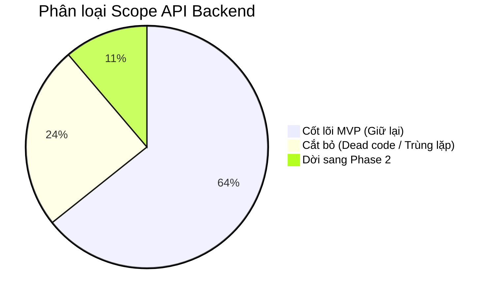

# Kế Hoạch Chuẩn Hóa Codebase & Rà Soát Scope API Backend

> **Cập nhật:** 2026-11-02  
> **Mục tiêu:**  
> 1. Hướng dẫn kỹ thuật chuẩn hóa phân quyền bằng `@PreAuthorize` và gộp Controller theo Domain.  
> 2. Phân loại Scope toàn bộ API: **MVP Cốt lõi**, **Dời sang Phase 2**, **Cắt bỏ hoàn toàn**.  
> *(Danh sách phân công chi tiết cho từng thành viên đã được tách riêng sang `BE_TODO.md` và `FE_TODO.md`).*  
> *(Lưu ý: Tuyệt đối không commit lên Git khi chưa có yêu cầu).*

---

## PHẦN 1. Hướng Dẫn Kỹ Thuật: Chuẩn Hóa Controller & Phân Quyền Bằng `@PreAuthorize`

### 1.1. Nguyên tắc
* **Một Domain = Một Controller duy nhất:** Không chia tách các class Controller con chỉ để phục vụ từng vai trò (ví dụ: gộp `ProviderOrderController` vào `OrderController`).
* **Phân quyền tập trung tại Spring Security:** Gắn `@PreAuthorize` ở Controller và Service Interface. Tầng Service Implementation không kiểm tra Role thủ công (`if-else Role`).
* **Service chỉ xử lý nghiệp vụ:** Chỉ kiểm tra tài khoản tồn tại và có trạng thái `ACTIVE` qua `requireActiveUser()`.

### 1.2. Mẫu triển khai chuẩn

#### Tại Controller
```java
@RestController
@RequiredArgsConstructor
@Tag(name = "Tên Module", description = "Mô tả module")
public class SampleController {
    private final SampleService sampleService;

    // Phân quyền rõ ràng trên từng method
    @GetMapping("/api/sample/me")
    @PreAuthorize("hasRole('CUSTOMER')")
    public ResponseEntity<ApiResponseDTO<?>> getMyData(...) { ... }

    @GetMapping({"/api/provider/sample", "/api/sample/provider"})
    @PreAuthorize("hasRole('PROVIDER')")
    public ResponseEntity<ApiResponseDTO<?>> getProviderData(...) { ... }

    @GetMapping("/api/sample/{id}")
    @PreAuthorize("hasAnyRole('CUSTOMER', 'PROVIDER')")
    public ResponseEntity<ApiResponseDTO<?>> getDetail(@PathVariable UUID id) { ... }
}
```

#### Tại Service Interface
```java
public interface SampleService {
    @PreAuthorize("hasRole('CUSTOMER')")
    PageResponse<?> getMyData(QueryRequest query);

    @PreAuthorize("hasRole('PROVIDER')")
    PageResponse<?> getProviderData(QueryRequest query);

    @PreAuthorize("hasAnyRole('CUSTOMER', 'PROVIDER')")
    DetailResponse getDetail(UUID id);
}
```

#### Tại Service Implementation
```java
@Service
@RequiredArgsConstructor
public class SampleServiceImpl implements SampleService {
    private final SecurityContextService securityContextService;

    private User requireActiveUser() {
        User user = securityContextService.getCurrentUser();
        if (user.getStatus() != UserStatus.ACTIVE) {
            throw new ResponseStatusException(HttpStatus.UNAUTHORIZED, "User is not active");
        }
        return user;
    }

    @Override
    public PageResponse<?> getMyData(QueryRequest query) {
        User buyer = requireActiveUser(); // Role đã được @PreAuthorize chặn trước đó
        return repository.findByBuyerId(buyer.getId(), ...);
    }
}
```

---

## PHẦN 2. Rà Soát Scope API Tổng Thể: MVP vs. Phase 2 vs. Cắt Bỏ

Tổng số endpoint hiện tại: **~98 API** thuộc 19 Controller.



---

### Nhóm 1: Cần Thiết Cho MVP (Core Scope - Bắt buộc giữ lại & Chuẩn hóa)

| Phân hệ | API Endpoint | Vai trò & Mục đích |
| :--- | :--- | :--- |
| **Auth** | `POST /api/auth/register` | Đăng ký Buyer / Seller (lưu thông tin ngân hàng) |
| | `POST /api/auth/login` | Đăng nhập cấp JWT |
| | `POST /api/auth/google` | Đăng nhập Google OAuth |
| | `POST /api/auth/refresh` | Làm mới access token qua Axios |
| | `GET /api/auth/me` | Lấy profile người dùng hiện tại |
| | `POST /api/auth/change-password` | Đổi mật khẩu |
| | `POST /api/auth/forgot-password`, `/verify-otp`, `/reset-password` | Quên mật khẩu qua email OTP |
| | `POST /api/auth/logout` | Đăng xuất, hủy cookie xác thực |
| **KYC** | `POST /api/provider/compliance/upload` | Seller tải lên GPKD, ATTP, CCCD |
| | `GET /api/provider/compliance` | Seller xem tiến độ duyệt hồ sơ |
| | `GET /api/admin/compliance/status/{status}` | Admin lọc hồ sơ KYC (`PENDING`, `APPROVED`, `REJECTED`) |
| | `PUT /api/admin/compliance/{id}/approve`, `/reject` | Admin duyệt hoặc từ chối kèm lý do |
| **SaaS** | `GET /api/provider/subscriptions/plans` | Xem bảng giá gói bán hàng sàn |
| | `POST /api/provider/subscriptions` | Seller đăng ký gói kèm mã giao dịch |
| | `GET /api/provider/subscriptions` | Seller xem lịch sử gói |
| | `PUT /api/provider/subscriptions/{id}/cancel` | Seller hủy gói chưa thanh toán |
| | `GET /api/admin/subscriptions/status/{status}` | Admin lọc danh sách đăng ký gói |
| | `PUT /api/admin/subscriptions/{id}/activate` | Admin xác nhận đã nhận tiền và kích hoạt gói |
| **Catalog** | `GET /api/products`, `GET /api/products/{id}`, `GET /api/products/images/{id}` | Khách xem danh mục sản phẩm, biến thể, hình ảnh |
| | `GET /api/provider/products`, `POST /api/provider/products` | Seller xem và tạo sản phẩm của tiệm |
| | `PUT /api/provider/products/{id}`, `PUT /.../images`, `POST /.../archive` | Seller cập nhật thông tin, ảnh, lưu trữ sản phẩm |
| | `POST /.../variants`, `PUT /.../variants/{id}`, `DELETE /.../variants/{id}` | Seller quản lý biến thể bánh (trọng lượng, giá, SKU) |
| | `POST /.../variants/{id}/imports` | Nhập kho tăng số lượng tồn `stock_quantity` |
| **Capacity** | `GET /api/providers/{providerId}/available-dates` | Khách xem ngày nhận hàng còn slot nướng |
| | `GET /api/provider/capacities`, `PUT /api/provider/capacities` | Seller xem và cài đặt công suất lò nướng theo ngày |
| | `GET /api/provider/bake-sheet?date=YYYY-MM-DD` | Seller xuất và in phiếu nướng bánh theo ngày từ `v_bake_lines` (BE4 Luân phụ trách - Đã hoàn thành [OK]) |
| **Checkout & Order** | `POST /api/checkout/preview` | Tính toán tiền hàng, ship, cọc (không chiếm giữ kho) |
| | `POST /api/checkout` | Submit đặt hàng, trừ tồn/capacity, tách đơn đa Provider |
| | `GET /api/orders/me` | Buyer xem đơn hàng của mình |
| | `GET /api/orders/{id}` | Buyer & Seller xem chi tiết đơn hàng |
| | `GET /api/provider/orders` (hoặc `/api/orders/provider`) | Seller xem danh sách đơn của tiệm |
| | `POST /api/provider/orders/{id}/confirm-deposit` | Seller xác nhận đã nhận cọc trước hạn hold |
| | `POST /api/orders/{id}/cancel` | Hủy đơn trước sản xuất, nhả kho/capacity |
| | `PATCH /api/provider/orders/{id}/status` | Chuyển trạng thái đơn: Chờ nướng -> Giao hàng -> Hoàn thành |
| | `GET /api/orders/{id}/vietqr` | Sinh mã VietQR động thanh toán cọc Napas 247 |
| | `GET`, `PUT /api/provider/checkout-settings/bank-account` | Cài đặt thông tin tài khoản ngân hàng nhận tiền của tiệm |
| **B2B RFQ** | Cụm 7 API RFQ trong `RfqController` | Doanh nghiệp gửi yêu cầu báo giá sỉ bánh và Seller chốt báo giá |
| **Promotions** | Cụm 5 API trong `PromotionController` | Mã giảm giá công khai và mã riêng của Seller |
| **Complaints** | Cụm 6 API trong `ComplaintController` | Quy trình khiếu nại, đổi trả bánh hỏng giữa Khách, Seller và Admin |

---

### Nhóm 2: Chuyển Sang Phase 2 (Dời sang giai đoạn mở rộng)

| API / Phân hệ | Lý do chuyển Phase 2 |
| :--- | :--- |
| **Custom Box & Set quà động** (`/composition`, `/components`, `/set-adjustments`) | MVP chỉ bán bánh lẻ và Hộp quà cố định (Fixed Set). Cơ chế tự phối hộp quà động và xả kho 2 tầng phức tạp dời sang Phase 2. |
| **Đồng bộ Giỏ hàng Đa thiết bị** (`/api/cart/**`) | Giỏ hàng B2C MVP hiện lưu tại LocalStorage phía FE1, khi Checkout gửi trực tiếp payload. Cụm API giỏ hàng trên DB sẽ kích hoạt ở Phase 2 khi có tính năng đồng bộ app mobile/web. |
| **Tự động hết hạn gói SaaS** (`PUT /api/admin/subscriptions/{id}/expire`) | MVP chỉ cần nạp tiền đối soát thủ công và kích hoạt. Tính năng tự động quét hết hạn gói sẽ làm cùng Cron Phase 2. |
| **Giao hàng nhiều đợt trong 1 đơn** | MVP quy định mỗi đơn một ngày nhận duy nhất. |

---

### Nhóm 3: Cắt Bỏ Hoàn Toàn (Dead Code / Trùng lặp / Over-engineering)

| Endpoint | File Controller | Lý do cắt bỏ |
| :--- | :--- | :--- |
| `POST /api/dummy/**` (4 API) | `DummyPaymentController` | API mock tạm thời khi chưa có Checkout BE3. Hiện đã có Checkout thật và VietQR thật, **xóa bỏ file này**. |
| `POST /api/auth/provider` | `AuthController` | Trùng lặp hoàn toàn với `POST /api/auth/login` và `POST /api/auth/google`. |
| `GET /api/provider/compliance/status` | `ProviderComplianceController` | Thừa vì `GET /api/auth/me` đã trả cờ `isComplianceApproved`. |
| `GET /api/admin/compliance/pending` | `AdminComplianceController` | Trùng lặp với `GET /api/admin/compliance/status/PENDING`. |
| `PUT /api/admin/compliance/{docId}/review` | `AdminComplianceController` | Trùng lặp với 2 API phân định rõ ràng `approve` và `reject`. |
| `GET /api/admin/subscriptions/pending` | `AdminSubscriptionController` | Trùng lặp với `GET /api/admin/subscriptions/status/PENDING_PAYMENT`. |
| `PUT /api/admin/subscriptions/{id}/cancel` | `AdminSubscriptionController` | Admin không thao tác hủy gói thay Seller trên giao diện. |
| `GET /api/provider/subscriptions/active` | `ProviderSubscriptionController` | Dư thừa, FE tự lọc từ danh sách gói. |
| `GET /api/provider/subscriptions/status` | `ProviderSubscriptionController` | Dư thừa, BE đã có `ProviderPolicyService` kiểm tra quyền bán ngầm. |
| `/audits`, `/stats`, `/order-stats` | `ProviderProductController` | Hệ thống sổ kho kép và biểu đồ thác nước over-engineering không có trong SRS MVP. |
| `POST /.../terminate`, `/discontinue` | `ProviderProductController` | Đã có API xóa/archive biến thể chuẩn. |
| `GET /api/provider/dashboard` | `ProviderDashboardController` | Thống kê doanh thu tạm bợ, nên thay bằng API báo cáo đơn hàng chuẩn. |

---

## PHẦN 3. Tài Liệu Phân Công Công Việc Chi Tiết

Toàn bộ các đầu việc triển khai cụ thể đã được tách riêng vào 2 file chuyên biệt:
* **Backend:** Xem chi tiết tại [`BE_TODO.md`](BE_TODO.md) (Phân chia công việc cho BE1 Tiến, BE2 Đạt, BE3 Phát, BE4 Luân).
* **Frontend:** Xem chi tiết tại [`FE_TODO.md`](FE_TODO.md) (Phân chia công việc cho FE2 Thạch, FE1 Tuấn).
